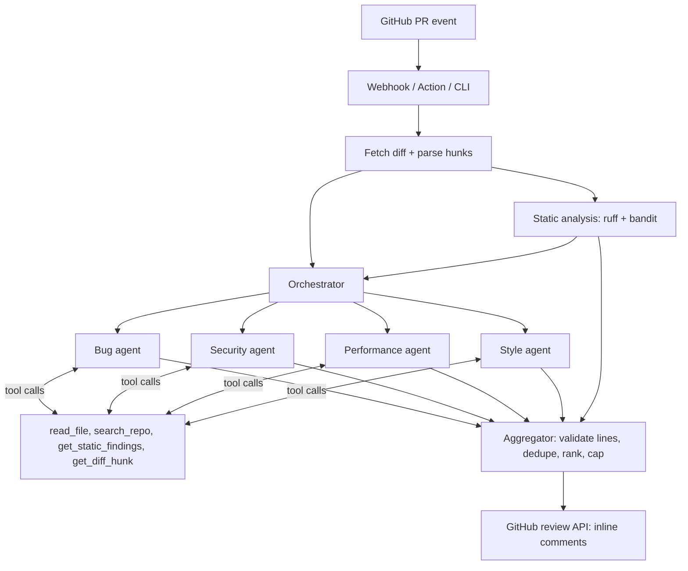

# ai-pr-code-reviewer

**Multi-agent AI code reviewer for GitHub pull requests: parallel specialist agents with tool use, grounded in static analysis, posting line-anchored structured comments, and measured on a seeded-bug eval set.**

  [](https://github.com/Alkarim786/ai-pr-code-reviewer/actions/workflows/ci.yml)

*Project 12 of Karim's 30 Days, 30 Projects series.*

## Problem

LLM reviewers tend to hallucinate line numbers, flood PRs with nitpicks and can be steered by text inside the PR itself. This project treats the model as an untrusted proposer: it gets read-only tools and static-analysis evidence, must answer in a validated schema, and deterministic code decides what is actually posted.

## Architecture



**Data flow.** The PR diff is parsed into hunks with a new-file line map. Ruff and bandit run on the changed Python files (they only parse; PR code is never executed). Four specialist agents run concurrently (`asyncio.gather`), each in its own tool-use loop (max 6 turns, token budget), and finish by calling `submit_findings`, validated by Pydantic. The aggregator drops any comment whose line is not in the diff, merges findings within 2 lines in the same file and category (static plus LLM agreement ranks higher), ranks by severity, caps the count and posts one review.

## Tech stack

| Piece | Choice | Why |
|---|---|---|
| Language | Python 3.13, asyncio | agents are I/O bound; parallelism is cheap |
| LLM | Anthropic Messages API, tool use (`ANTHROPIC_MODEL`) | native tool calling; model is configurable |
| Schemas | Pydantic v2 | invalid model output is rejected and counted, never posted |
| Static analysis | ruff, bandit | fast, JSON output, evidence for the agents |
| GitHub | httpx REST client | small surface: diff, contents, reviews |
| Service | FastAPI webhook (HMAC-verified), GitHub Action, CLI | three ways to run the same pipeline |
| Tests | pytest, pytest-asyncio, respx | recorded-style HTTP mocks, scripted `FakeLLM` |

## Features

- Diff parser with hunk to new-file-line mapping; comments can only land on lines GitHub accepts.
- Four specialist agents (bug, security, performance, style) with read-only tools.
- Static findings given to agents as evidence and merged into the result.
- Deterministic aggregator: location validation, dedupe, ranking, comment cap.
- Per-PR token budget; a failing agent does not fail the review.
- Dry-run CLI, `review-pr` command (posts a review), FastAPI webhook, Docker image, example GitHub Action.
- `FakeLLM` for offline tests and evals.

## Roadmap (not built)

- ESLint/semgrep analysers (only ruff and bandit today, so only Python files get static evidence).
- Having the LLM verify or suppress noisy static findings before posting (see eval: it costs precision).
- Learning from 👍/👎 reactions, file-read caching, a model-graded eval, resolving stale comments on new pushes.

## Key engineering decisions

- **Model proposes, code disposes.** Grounding is deterministic and unit-tested, so "no hallucinated locations" is a guarantee, not a prompt hope.
- **Specialists in parallel** with focused prompts, instead of one giant prompt: better precision per category and bounded latency.
- **Prompt-injection posture.** Diff content is wrapped in `<untrusted_diff>` tags and the system prompt says it is data. The real defence is structural: tools are read-only, paths are normalised (no absolute paths, `..` or symlink escapes), and bad output is filtered.
- **Cost control.** Annotated diffs instead of whole files, truncated tool output, a turn limit, a token budget and a comment cap.
- **Trade-off:** static findings are posted even when no LLM agrees. That raises recall and lowers precision (see below).

## Quick start

```bash
cp .env.example .env        # set ANTHROPIC_API_KEY, GITHUB_TOKEN, GITHUB_WEBHOOK_SECRET
docker compose up --build   # webhook on :8080 (/healthz, /webhook)
```

Local dev:

```bash
python -m venv .venv && . .venv/bin/activate    # Windows: .venv\Scripts\activate
pip install -e ".[dev]"
python -m reviewer review --diff change.diff --repo . --static-only   # no API key needed
python -m reviewer review --diff change.diff --repo .                 # with LLM agents
python -m reviewer review-pr --repo-name owner/repo --pr 12 --repo-dir . --post
```

`.github/workflows/review.yml` is an example Action (falls back to `--static-only` without the secret; fork PRs never receive secrets).

## API

`POST /webhook` (headers `X-GitHub-Event`, `X-Hub-Signature-256`): `pull_request` events with action `opened`, `synchronize`, `reopened` or `ready_for_review` (non-draft) return `202 {"status":"queued"}`; bad signature returns `401`; `GET /healthz` returns `{"status":"ok"}`.

Each posted comment is a structured finding: `file`, `line`, `severity` (critical..info), `category` (bug/security/performance/style), `message`, optional `suggestion`, `source` (`llm`, `static`, `static+llm`).

## Testing

```bash
pytest -q          # 52 tests (1 skipped on Windows: symlink test needs privileges)
ruff check .
python -m eval.run_eval
```

Covered: diff/hunk mapping, tool sandboxing (traversal, symlinks, regex errors, truncation), schema validation, aggregator dedupe/ranking/grounding, agent loop (bounded turns, tool errors, invalid output), GitHub client against mocked HTTP (respx), webhook signatures and dispatch, end-to-end with real ruff/bandit plus a scripted LLM, and eval-set consistency. CI runs lint, tests, the eval and a Docker build.

## Evaluation

Hardware: AMD Ryzen 5 7520U (4C/8T), 15.2 GB RAM, Windows 11. Set: 28 small PRs (18 with seeded bugs, 19 labelled issues across 17 bug types; 10 clean PRs). A finding matches when file and category agree and lines are within 2.

| Mode | Precision | Recall | F1 | TP / FP / FN | Clean PRs with a false positive |
|---|---|---|---|---|---|
| Static only (ruff + bandit, real) | 0.765 | 0.684 | 0.722 | 13 / 4 / 6 | 1 / 10 |
| LLM agents only (**scripted**) | 0.882 | 0.789 | 0.833 | 15 / 2 / 4 | 2 / 10 |
| Combined (**scripted** agents + static) | 0.739 | 0.895 | 0.810 | 17 / 6 / 2 | 3 / 10 |

**Important caveat: no real model was evaluated.** No `ANTHROPIC_API_KEY` was available when this was built. The "scripted" rows replay responses I hand-wrote (`eval/cases.py`), including deliberate misses, false positives, an out-of-diff line and a malformed finding. They exercise the pipeline (grounding, dedupe, merging) but say nothing about model quality. The static-only row is real tool output. Run `python -m eval.run_eval --modes static,llm` with a key for real model numbers; they have not been measured.

What the real parts do show: static analysis alone is strong on security patterns (security recall 1.0) but misses logic bugs (bug recall 0.44) and adds noise (e.g. bandit flags `import subprocess`), and posting static findings unfiltered cost precision in the combined run. Pipeline counters on the scripted runs: the aggregator dropped the out-of-diff finding and the malformed one. Latency is dominated by ruff and bandit process start-up (about 4.3 s/PR on this machine while Docker Desktop was starting; 8 ms/PR without static analysis).

## Project structure

```
reviewer/
  diff.py            unified diff parser, line map
  static_analysis.py ruff + bandit runners
  tools.py, sources.py  read-only agent tools, path sandbox
  llm.py             Anthropic client + FakeLLM
  agents.py          specialist prompts + tool-use loop
  aggregator.py      validate, dedupe, rank, format
  orchestrator.py    parallel run
  github_client.py, pr_review.py, webhook.py, cli.py
eval/                cases.py (28 PRs), run_eval.py
tests/               52 tests
.github/workflows/   ci.yml, review.yml (example)
```

## License

MIT
